# Friday · Work OS

一个 **Monday 风格** 的 feature / 项目管理工作台：看板、分组、表格、Kanban、活动流、评论、搜索、Dashboard，以及完整的账户体系（密码、TOTP、PAT Scope、OIDC）。

前端由 **Go 单体直接托管**：生产构建会通过 `go:embed` 把 SPA 打进 Go 二进制，部署时只需要一个进程 + MongoDB。

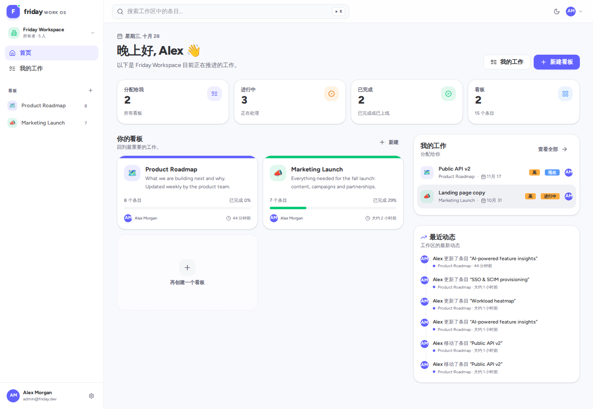

## 功能

- **Board / Group / Item**：Monday 风格的彩色分组、行内编辑、折叠、拖拽跨组移动。
- **多视图**：Main table、Kanban（按状态分列，支持跨列拖拽）、**Gantt 甘特图**（日/周/月缩放、今日线）、Activity 时间线。
- **列类型**：Status、Priority、Text、People、Date、Numbers、Checkbox；支持新增、重命名、删除列。
- **Gantt**：根据 Start date / Due date（或 Target date）自动绘制时间条，按状态着色，支持 Day / Week / Month 缩放。
- **协作**：评论、活动流、Dashboard、全局搜索、My work。
- **多租户 Workspace**：工作区切换、成员管理、邀请链接、Owner/Admin/Member/Guest 角色。
- **Board 级共享**：Workspace / Private 可见性，显式成员与 Viewer/Commenter/Editor/Admin 角色。
- **账户安全**：忘记密码、SMTP 邮件、登录限流、安全响应头、登录设备管理、TOTP 恢复码。
- **国际化**：English + 简体中文，语言选择持久化，日期格式随语言切换。
- **部署**：单个 Go 二进制 / Dockerfile / docker-compose / GitHub Actions。
- **认证**
  - 邮箱 + 密码（bcrypt）
  - TOTP 两步验证（二维码 + 6 位动态码）
  - Personal Access Token（`fdy_…`，细粒度 scope，可过期/撤销）
  - OIDC / SSO（Keycloak、Authentik、Auth0、Okta、Google 等）
- **安全**：HttpOnly Session Cookie、Double-submit CSRF、PAT 哈希存储、OIDC state + nonce 校验、email 验证状态检查。
- **低内存友好**：Go 单并发编译、Node 内存限制、可配置 Mongo cache。

## 技术栈（mise 管理）

| 层 | 技术 |
| --- | --- |
| 工具链 | [mise](https://mise.jdx.dev/) |
| 前端 | React 19、TypeScript、Vite、Tailwind CSS v4、shadcn/ui 风格组件、Radix UI、TanStack Query、React Router、i18next、pnpm |
| 后端 | Go（chi、mongo-driver、bcrypt、pquerna/otp、coreos/go-oidc） |
| 数据库 | MongoDB 8 |
| 托管 | Go `go:embed` 嵌入前端构建产物 → 单二进制 |

## 目录

```text
friday/
├── .mise.toml                  # 工具版本 + tasks
├── .env.example
├── backend/
│   ├── cmd/server/main.go
│   ├── internal/
│   │   ├── api/                # HTTP handlers、middleware、seed
│   │   ├── auth/               # 密码、Session、TOTP、PAT、OIDC
│   │   ├── config/             # 环境变量
│   │   ├── database/           # Mongo 连接 + 索引
│   │   ├── models/
│   │   └── web/                # go:embed 的 SPA 构建产物
│   └── go.mod
├── frontend/
│   ├── src/
│   │   ├── components/         # 布局、表格、Kanban、抽屉、shadcn UI
│   │   ├── pages/              # Dashboard、Board、My work、Workspace、Settings、Auth
│   │   ├── i18n/               # i18next 初始化 + 中文词条
│   │   └── lib/                # API client、类型、查询/变更、Workspace Context
│   └── vite.config.ts
└── docs/screenshots/
```

## 快速开始

### 1. 依赖

- mise
- MongoDB（默认 `mongodb://127.0.0.1:27017`）

```bash
# 如果本机还没有 MongoDB
mongod --dbpath /path/to/mongo-data --bind_ip 127.0.0.1 --port 27017
```

### 2. 安装

```bash
cp .env.example .env
mise install
mise run install
```

### 3. 开发模式（Vite + Go）

```bash
mise run dev
```

- 前端：<http://localhost:5173>（Vite 会把 `/api` 代理到 Go）
- API：<http://localhost:8090>

也可以分开启动：

```bash
mise run dev:api
mise run dev:web
```

### 4. 生产模式（Go 托管前端，单进程）

```bash
mise run build     # 构建 SPA → 复制到 backend/internal/web/dist → 编译 Go 二进制
mise run serve     # 运行 backend/bin/friday-server
```

打开 <http://localhost:8090>。此时 `/`、`/assets/*`、`/api/*` 全部由 Go 提供。

> 修改前端后请执行 `mise run build`，否则 Go 二进制里仍是上一次嵌入的 SPA。

### 5. Demo 账号

执行 `mise run serve` 或 `mise run dev` 且 `SEED_DEMO=true` 时，首次会生成演示数据：

| 账号 | 密码 | 说明 |
| --- | --- | --- |
| `admin@friday.dev` | `friday123` | 主演示账号（Alex Morgan） |
| `maya@friday.dev` | `friday123` | Maya Chen |
| `sam@friday.dev` | `friday123` | Sam Rivera |
| `jordan@friday.dev` | `friday123` | Jordan Lee |
| `priya@friday.dev` | `friday123` | Priya Patel |

演示数据包含一个 Friday Workspace、Product Roadmap / Marketing Launch 两个 board、分组、条目、负责人、评论与活动流。

未登录时也可以通过邀请链接 `http://localhost:8090/invite/<token>` 查看邀请并注册/登录后接受。

## 环境变量

| 变量 | 默认值 | 说明 |
| --- | --- | --- |
| `PORT` | `8090` | Go 监听端口 |
| `APP_URL` | `http://localhost:8090` | 前端地址，OIDC 回调成功后跳转、CORS 白名单 |
| `MONGO_URI` | `mongodb://127.0.0.1:27017` | MongoDB 地址 |
| `MONGO_DB` | `friday` | 数据库名 |
| `ALLOW_REGISTRATION` | `true` | 是否开放自助注册 |
| `SEED_DEMO` | `true` | 是否生成演示数据 |
| `SESSION_TTL_HOURS` | `168` | Session 有效期（小时） |
| `COOKIE_SECURE` | 由 `APP_URL` 是否 https 推断 | 生产 HTTPS 请设为 `true` |
| `CORS_ORIGINS` | `http://localhost:5173,http://127.0.0.1:5173` | 额外允许的跨域来源 |
| `FRONTEND_DIST` | 空 | 非空时改为从磁盘目录读取 SPA（调试用） |
| `OIDC_ISSUER` | 空 | OIDC Issuer |
| `OIDC_CLIENT_ID` | 空 | OIDC Client ID |
| `OIDC_CLIENT_SECRET` | 空 | OIDC Client Secret |
| `OIDC_REDIRECT_URL` | `http://localhost:8090/api/auth/oidc/callback` | 必须与 IdP 配置一致 |
| `OIDC_NAME` | `Single sign-on` | 登录页按钮文案 |
| `SMTP_HOST` | 空 | SMTP 服务器；空则把邮件内容打印到日志 |
| `SMTP_PORT` | `587` | SMTP 端口 |
| `SMTP_USERNAME` / `SMTP_PASSWORD` | 空 | SMTP 认证 |
| `SMTP_FROM` | `Friday <no-reply@friday.local>` | 发件人 |
| `SMTP_FROM_NAME` | `Friday` | 发件人名称 |
| `SMTP_TLS` | `true` | 是否使用 STARTTLS |
| `SMTP_IMPLICIT_TLS` | `false` | 465 隐式 TLS |

## 认证设计

### 浏览器 Session

- 登录成功写入 `friday_session`（HttpOnly、SameSite=Lax、可 Secure）和 `friday_csrf`（前端可读）。
- 所有写操作需要 `X-CSRF-Token` 与 `friday_csrf` 一致（Double-submit）。
- Session token 随机 256-bit，数据库只存 SHA-256 哈希；Mongo TTL 自动清理过期 Session。
- 退出登录会删除 Session 并清 Cookie。

### TOTP

1. `POST /api/me/totp/setup` 生成 secret 与 `otpauth://` URL。
2. 前端渲染二维码，用户扫码。
3. `POST /api/me/totp/enable` 提交 6 位码后启用。
4. 下次密码登录返回 `{ "totpRequired": true, "challengeToken": "..." }`。
5. `POST /api/auth/login/totp` 提交 challenge + code 完成登录（5 次失败后 challenge 失效）。
6. 关闭 2FA 同样需要当前动态码。

### Personal Access Token（PAT）

- 仅浏览器 Session 可以创建/撤销 PAT，PAT 本身不能管理 PAT。
- Token 形如 `fdy_…`，数据库只存 SHA-256 哈希，创建后仅显示一次。
- 支持过期时间（最长 365 天）与 `lastUsedAt`。
- Scope 采用 `resource:action`，写权限隐含同资源的读权限。

| Scope | 能力 |
| --- | --- |
| `boards:read` | 读取 board、group、column |
| `boards:write` | 创建/修改/删除 board、group、column |
| `items:read` | 读取 item、comment、activity、搜索 |
| `items:write` | 创建/修改/移动/删除 item、comment |
| `users:read` | 读取工作区成员列表 |

```bash
TOKEN=fdy_xxx
curl -H "Authorization: Bearer $TOKEN" http://localhost:8090/api/boards
```

PAT 使用 Bearer Header，不依赖 Cookie，因此不需要 CSRF Token。

### OIDC

以 Keycloak 为例：

```env
OIDC_ISSUER=https://keycloak.example.com/realms/acme
OIDC_CLIENT_ID=friday
OIDC_CLIENT_SECRET=change-me
OIDC_REDIRECT_URL=https://friday.example.com/api/auth/oidc/callback
OIDC_NAME=Company SSO
APP_URL=https://friday.example.com
COOKIE_SECURE=true
```

IdP 中登记的 Redirect URI 必须与 `OIDC_REDIRECT_URL` 完全一致。流程：

```text
GET /api/auth/oidc/start
  → 生成 state + nonce，写短期 Cookie，跳转 IdP
GET /api/auth/oidc/callback
  → 校验 state、code 换 token、校验 id_token 签名 / nonce / email_verified
  → 按 (issuer, subject) 查找用户；否则按 email 绑定或创建用户
  → 创建 Session Cookie → 跳转 APP_URL
```

## 主要 API

| Method | Path | Scope |
| --- | --- | --- |
| `POST` | `/api/auth/register` | 公开（可关闭） |
| `POST` | `/api/auth/login` | 公开 |
| `POST` | `/api/auth/login/totp` | 公开 |
| `GET` | `/api/auth/oidc/start` / `callback` | 公开 |
| `GET` | `/api/auth/me` | 登录 |
| `POST` | `/api/auth/logout` | 登录 |
| `GET` | `/api/boards` | `boards:read` |
| `POST` | `/api/boards` | `boards:write` |
| `GET/PATCH/DELETE` | `/api/boards/{id}` | `boards:read/write` |
| `POST` | `/api/boards/{id}/groups` | `boards:write` |
| `PATCH/DELETE` | `/api/groups/{id}` | `boards:write` |
| `POST` | `/api/boards/{id}/columns` | `boards:write` |
| `PATCH/DELETE` | `/api/boards/{id}/columns/{cid}` | `boards:write` |
| `GET/POST` | `/api/boards/{id}/items` | `items:read/write` |
| `GET/PATCH/DELETE` | `/api/items/{id}` | `items:read/write` |
| `GET/POST` | `/api/items/{id}/comments` | `items:read/write` |
| `GET` | `/api/dashboard` | `boards:read` |
| `GET` | `/api/my-items` | `items:read` |
| `GET` | `/api/search?q=` | `items:read` |
| `GET` | `/api/users` | `users:read` |
| `GET` | `/api/boards/{id}/members` | `boards:read` + board admin |
| `PATCH/DELETE` | `/api/boards/{id}/members/{userId}` | `boards:write` + board admin |
| `POST` | `/api/auth/password-reset/request` | Public |
| `POST` | `/api/auth/password-reset/confirm` | Public |
| `GET/DELETE` | `/api/me/sessions` | Session |
| `DELETE` | `/api/me/sessions/{id}` | Session |
| `GET/POST` | `/api/workspaces` | Session |
| `GET/PATCH` | `/api/workspaces/{id}` | Session + role |
| `GET/PATCH/DELETE` | `/api/workspaces/{id}/members/{userId}` | Session + admin |
| `GET/POST` | `/api/workspaces/{id}/invitations` | Session + admin |
| `GET` | `/api/invitations/{token}` | Public |
| `POST` | `/api/invitations/{token}/accept` | Session |
| `GET/POST/DELETE` | `/api/me/pats` | Session only |
| `POST` | `/api/me/totp/setup|enable|disable` | Session only |
| `POST` | `/api/me/password` | Session only |

分页、WebSocket 实时同步、文件上传等不在当前版本内。

## Workspace 与权限

### 多工作区

- 用户可属于多个 Workspace，左侧顶部切换；当前 Workspace 存在 `localStorage.friday-workspace-id`。
- 注册新用户会创建一个个人 Workspace + 首个 board。
- 所有 board、成员、邀请都按 Workspace 隔离；API 也会校验 Workspace 成员关系。
- 不包含计费/套餐；`plan` 字段未实现，后续可扩展。

### Workspace 角色

| 角色 | 能力 |
| --- | --- |
| Owner | 所有权限；可转移/管理管理员，不能移除自己 |
| Admin | 管理成员、邀请、Workspace 设置；可访问所有 board |
| Member | 创建/编辑 Workspace 内公开 board；默认是 board editor |
| Guest | 只能访问明确共享给其的 private board |

### Board 权限

- `visibility = workspace`：Workspace 成员可访问；Member 默认 editor。
- `visibility = private`：仅 Workspace Owner/Admin、board owner 和显式 board members 可访问。
- Board 页右上角菜单可切换可见性（需要 board admin 权限）。
- 服务端对每个 board/item/comment 请求校验权限；PAT 同样受 Workspace/Board 权限限制。

### Board 级共享

- Board 右上角菜单 → **共享与权限**（需要 Board Admin）。
- `Workspace`：工作区所有成员可访问，默认 Editor。
- `Private`：仅 Board Owner、Workspace Owner/Admin 和显式 Board Members 可访问。
- 显式角色：Viewer、Commenter、Editor、Admin；可逐个成员覆盖“工作区默认”权限。
- 私有 Board 添加成员后，该成员可以通过共享链接直接访问。

### 邀请

- Workspace Owner/Admin 可生成邀请链接，绑定邮箱、角色，7 天过期。
- 配置 `SMTP_*` 后会发送邀请邮件；未配置时邀请链接会显示在 UI 并写入服务端日志。
- 被邀请人打开链接后可以注册/登录并接受；接受后自动切换到该 Workspace。
- 成员角色可修改；Owner 不能移除/降级；Admin 不能修改其他 Admin。

## 国际化（i18n）

- 已支持 **English** 与 **简体中文**。
- 语言切换入口：
  - 登录/注册/邀请页右上角；
  - 登录后右上角用户菜单 → Language。
- 选择写入 `localStorage.friday-locale`，刷新后保持。
- 日期使用 date-fns locale，中文下显示「10月28日」「3 分钟前」等。
- 词条位于 `frontend/src/i18n/zh.ts`，key 使用英文原文，缺失时自动回退英文。
- 新增语言：在 `frontend/src/i18n/index.ts` 注册资源与 `SUPPORTED_LANGUAGES`。
- 前端常见后端错误通过 `t(err.message)` 映射；完整的服务端 `Accept-Language` 本地化尚未实现。
- 用户输入内容（board 名、item 名等）不翻译；默认列标题和状态标签会按词条翻译。

## 邮件与密码重置

- `SMTP_*` 配置后发送邀请与密码重置邮件；未配置时使用 dev logger，链接写入服务端日志。
- `POST /api/auth/password-reset/request`：无论邮箱是否存在都返回 202，避免账号枚举。
- 重置链接 30 分钟有效；确认后更新密码并撤销该用户的所有 Session。
- 登录页提供“忘记密码？”入口；`/reset-password?token=...` 完成重置。
- 邀请链接 7 天有效，且与邮箱绑定。

## 安全加固

- 登录/注册/TOTP/密码重置均有内存级限流（按 IP + 路径）。
- 安全响应头：CSP、HSTS（HTTPS 时）、X-Frame-Options、X-Content-Type-Options、Referrer-Policy、Permissions-Policy。
- TOTP 启用时生成 10 个一次性恢复码，bcrypt 哈希存储；登录或关闭 2FA 时可用恢复码。
- 登录设备列表可查看 IP / User-Agent，支持撤销其他设备。
- Session 只存 SHA-256 哈希；CSRF Double-submit；PAT 只存哈希。
- 生产建议：`COOKIE_SECURE=true`、TLS 反向代理、MongoDB 认证、定期备份。
- **未实现**：邮箱验证、TOTP 恢复码重新生成、后端完整的 `Accept-Language` 本地化、登录审计日志。

## Docker 部署

```bash
docker compose up --build
```

或手动构建：

```bash
docker build -t friday .
docker run --rm -p 8090:8090 \
  -e MONGO_URI="mongodb://host.docker.internal:27017" \
  -e APP_URL="http://localhost:8090" \
  friday
```

- Dockerfile 多阶段构建：Node 构建 SPA → Go 嵌入 SPA → Alpine 运行。
- 生产请设置 `SMTP_*`、`APP_URL`、`COOKIE_SECURE=true`，并关闭/修改 demo 账号。
- GitHub Actions 位于 `.github/workflows/ci.yml`：Go vet/test/build、前端 typecheck/build、Docker build。

## 甘特图

在 Board 页面顶部选择 **Gantt** 标签页即可查看：

- 读取 `Start date`（标题或 ID 以 start/begin 开头）与 `Due date` / `Target date` / `End date` 日期列。
- 如果只有一列日期，会自动生成一条以该日期结尾、约一周长度的条。
- 条的颜色跟随 Status / Priority 列的颜色；红色描边表示日期已过。
- 支持 **Day / Week / Month** 缩放；红色虚线为今天。
- 点击时间条会打开条目详情抽屉。

新建 Project / Roadmap / Sprint 模板时自带 `Start date` 列；演示数据也已补齐起止日期。

## 截图

| Board | Gantt |
| --- | --- |
| 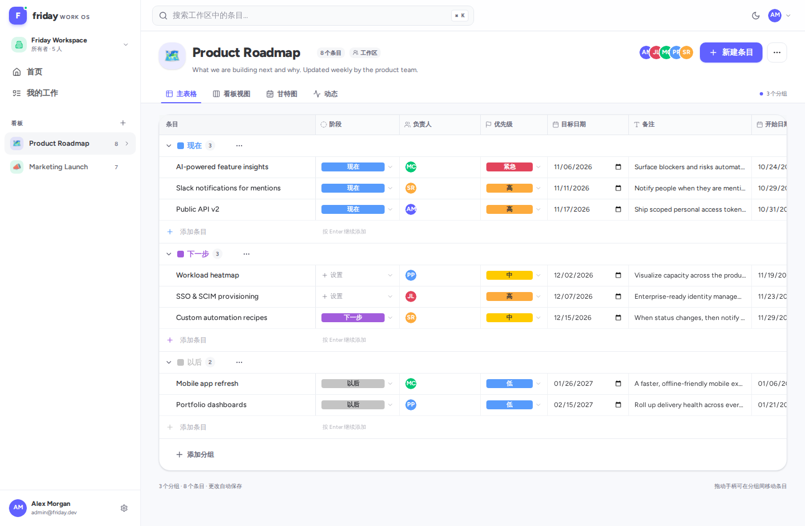 | 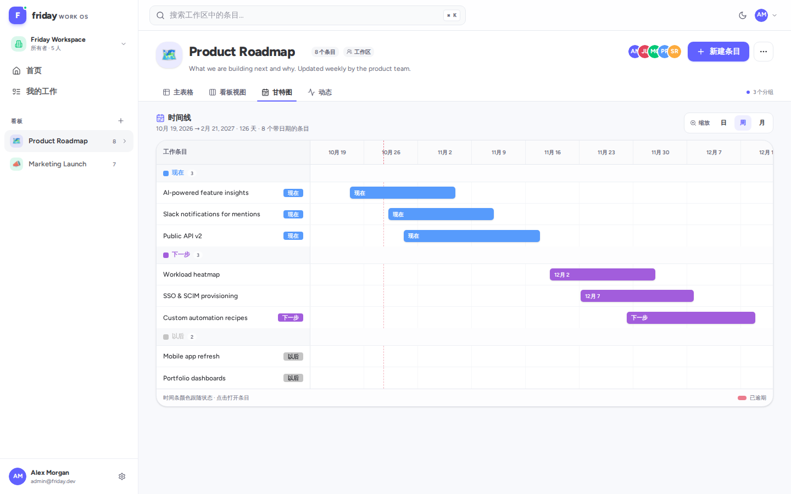 |

| Kanban | My work |
| --- | --- |
| 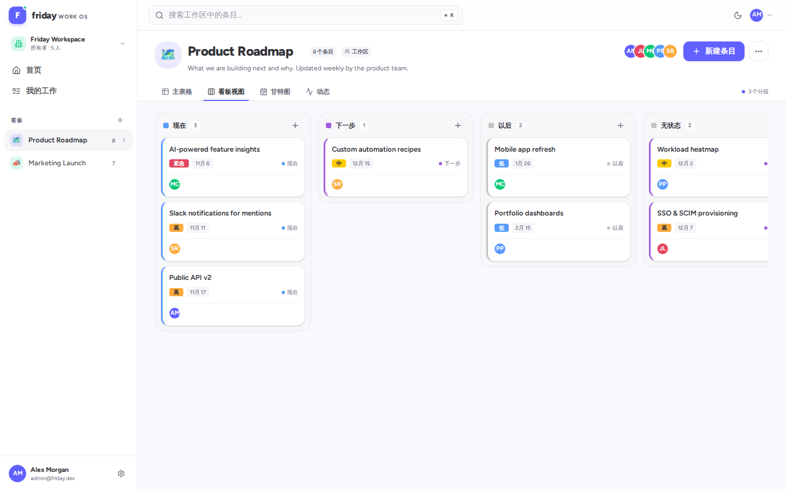 | 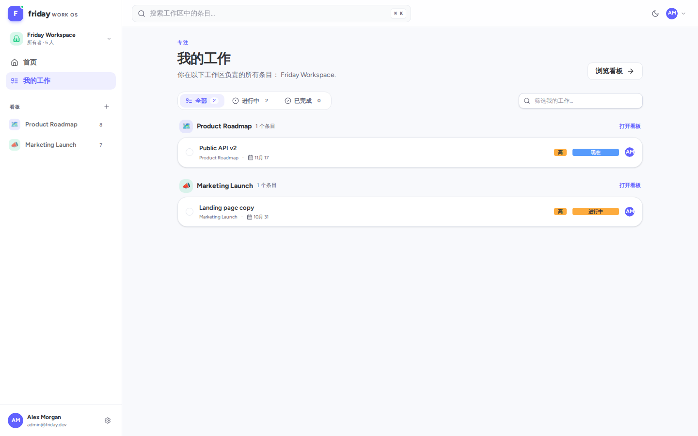 |

| Board sharing | Active sessions |
| --- | --- |
| 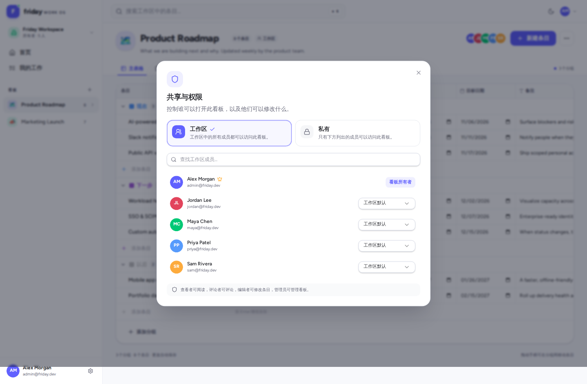 | 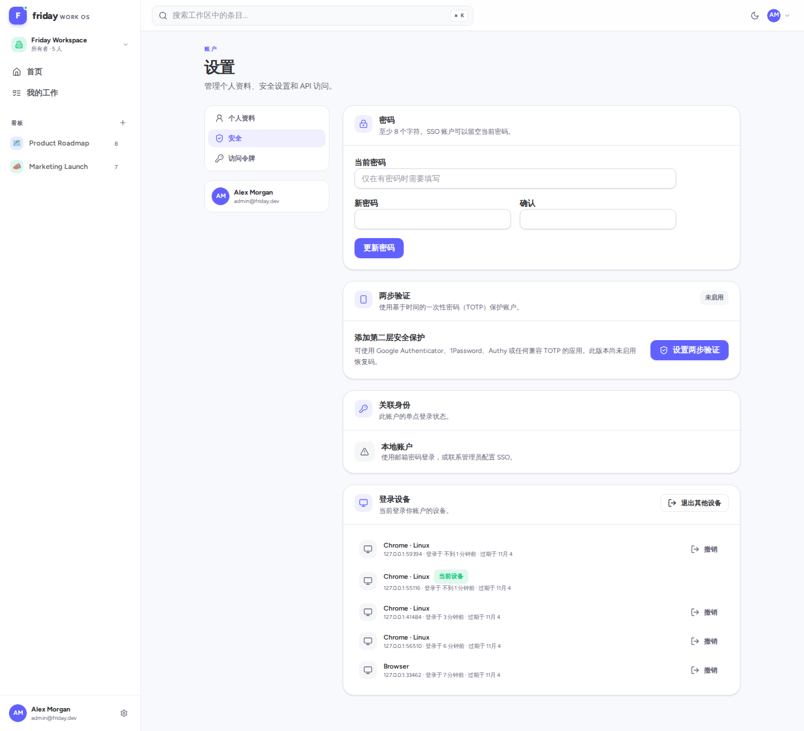 |

| Forgot password | English UI |
| --- | --- |
| 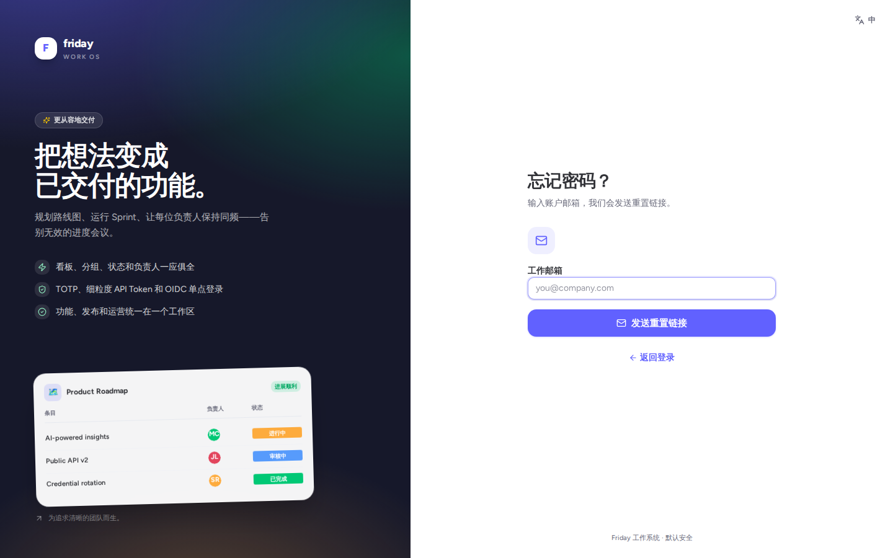 | 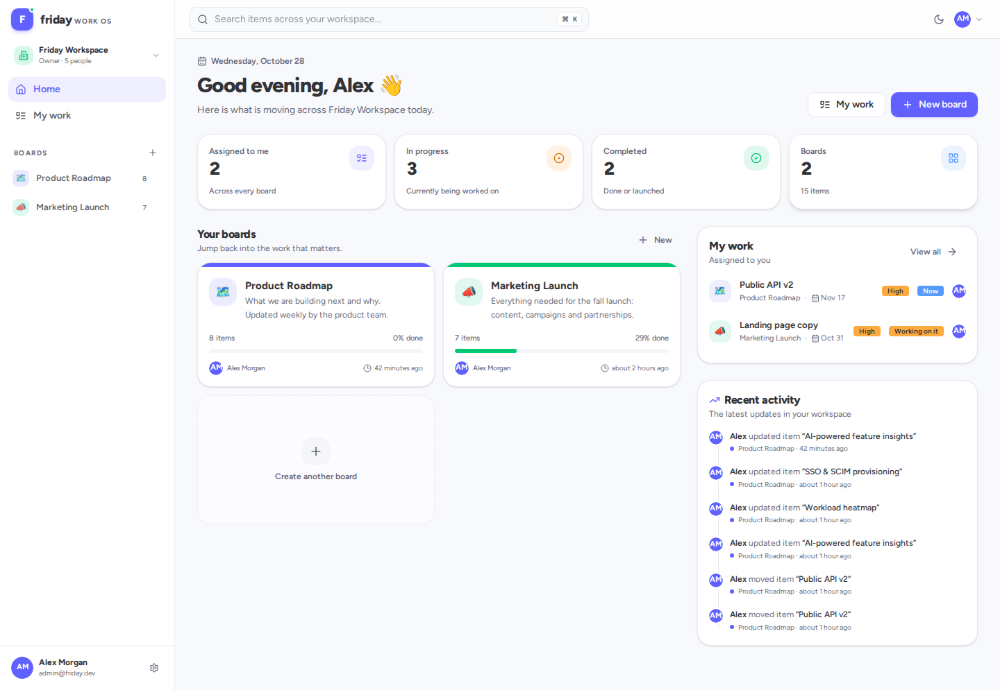 |

| Login | Settings |
| --- | --- |
| 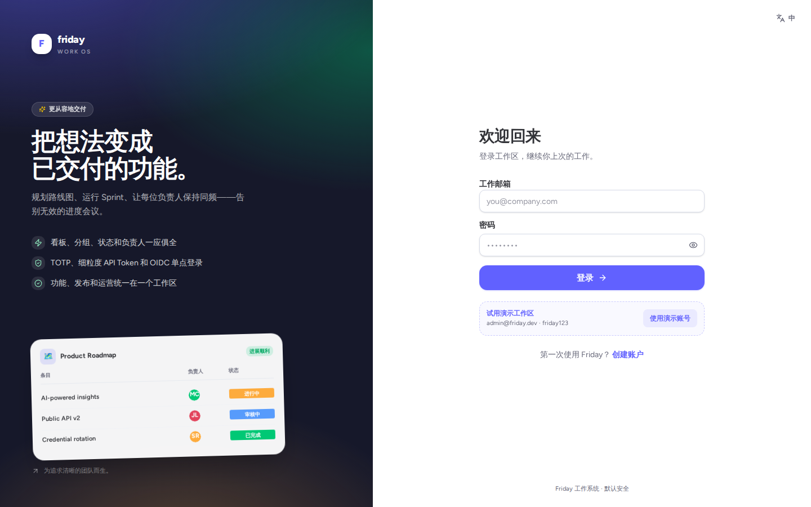 | 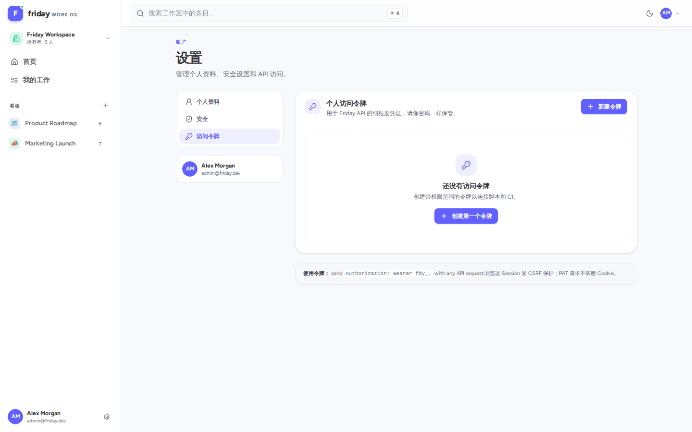 |

| 2FA Setup |
| --- |
| 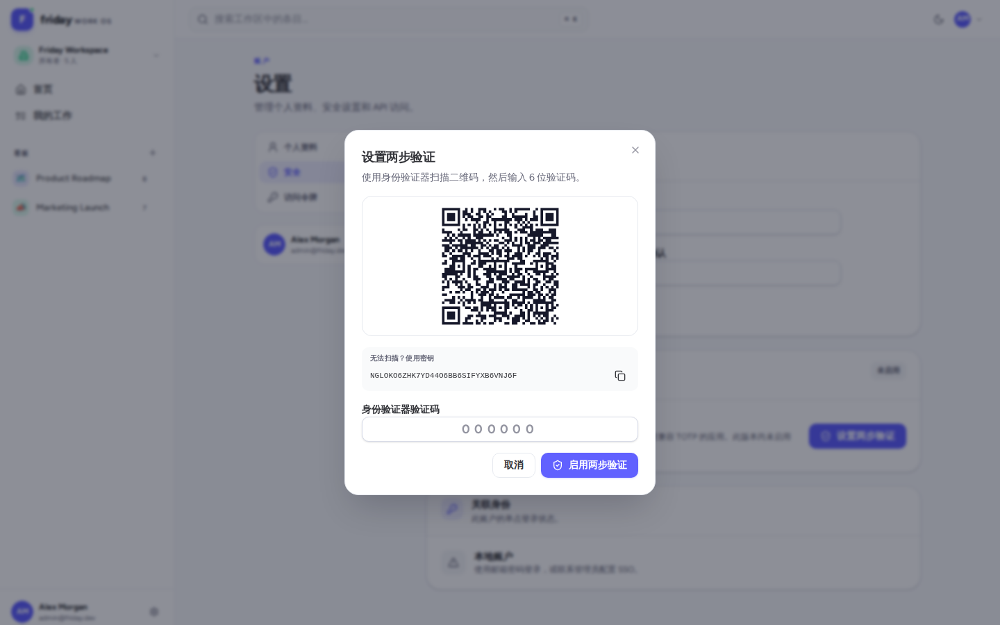 |

## 数据模型

MongoDB 集合：

- `users` — 用户、密码哈希、TOTP secret、OIDC 身份
- `workspaces` — 工作区
- `workspace_members` — 用户与工作区角色
- `invitations` — 邀请（哈希 Token、过期时间）
- `sessions` — 哈希后 Session + TTL 索引
- `password_reset_tokens` — 密码重置 Token + TTL 索引
- `login_challenges` — TOTP 登录短期 challenge
- `personal_access_tokens` — 哈希后 PAT、scope、过期时间
- `boards` — workspaceId、可见性、名称、颜色、图标、columns、成员
- `groups` — 分组、颜色、排序
- `items` — 名称、`values`（按 column ID 存值）、排序
- `comments` — 评论
- `activities` — 活动流

索引包含 `users.email` 唯一、`sessions.tokenHash` 唯一、TTL、`items(boardId, groupId, position)`、活动流等。

## 低内存说明

本项目在 1.6GB 内存环境里也可以构建：

- Go 构建使用 `GOFLAGS=-p=1`。
- 前端构建/安装设置 `NODE_OPTIONS=--max-old-space-size=512`。
- MongoDB 可限制 WiredTiger cache（例如 256MB）：

```yaml
storage:
  dbPath: /path/to/data
  wiredTiger:
    engineConfig:
      cacheSizeGB: 0.25
```

## 生产部署建议

- 使用反向代理（Caddy/Nginx）提供 TLS，设置 `APP_URL=https://…`、`COOKIE_SECURE=true`。
- 修改/删除 demo 账号；设置 `SEED_DEMO=false`、`ALLOW_REGISTRATION=false`。
- 为 MongoDB 开启认证，并只监听内网。
- 当前版本未内置登录限流；公网部署建议在代理层加 rate limit / fail2ban。
- 定期备份 MongoDB。

## 已知限制

- 没有邮箱验证（注册后可直接使用）。
- TOTP 恢复码只在启用时生成一次，暂不支持重新生成。
- 后端错误未做完整的 `Accept-Language` 服务端本地化，只在前端映射常见错误。
- 没有实时推送 / WebSocket，多人协作依赖刷新。
- 没有附件、子任务、自动化规则、日历视图。
- 甘特图暂不支持拖拽调整日期区间。
- 不做计费/订阅。
- OIDC 客户端代码已完成，但需接入真实 IdP 联调（等待用户中心）。
- SMTP 发送逻辑已完成，但需要用真实邮件服务器验证投递/退信。
- Docker/CI 文件已提供，但本地未执行完整 Docker 构建验证。
- 限流为单实例内存实现；多副本部署需要 Redis 等共享限流。
- 没有 Workspace 删除/所有权转移、邀请重发、撤销全部 PAT 等管理操作。
